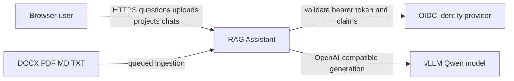
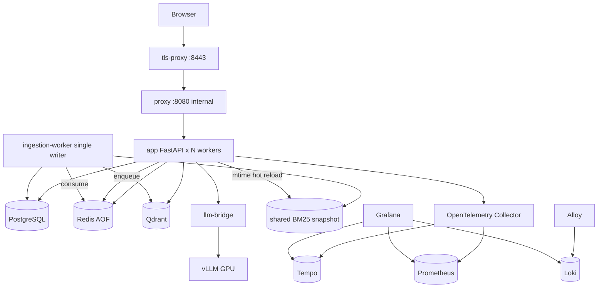
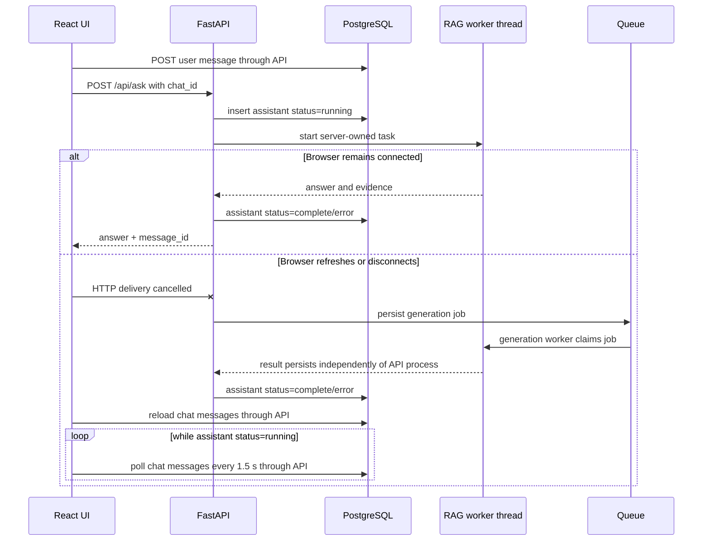

# Architecture: RAG Assistant

This document describes the runtime implemented by `compose.yaml` and the
current request paths. `compose.yaml` is authoritative; `docker-compose.yml` is
retained only for legacy development compatibility.

## System context

## Production containers

The backend network is internal. Only `tls-proxy` is externally bound by
default; `proxy` and Grafana bind to loopback unless explicitly changed.

## Component ownership

| Component | Owns | Does not own |
| --- | --- | --- |
| FastAPI (`asgi_app.py`) | HTTP contract, OIDC/RBAC, request IDs, durable assistant-message lifecycle, upload validation, job API | retrieval algorithms |
| Compatibility orchestration (`web_ui.py`) | chat-aware query contextualization, project prompt scope, Python/Rust flow selection, source enrichment and document isolation | persistence schema |
| RAG agent (`rag_agent.py`) | section-aware chunking, Qdrant/BM25 retrieval, reranking, prompt construction, exact answer cache keys, formula cleanup | project/chat lifecycle |
| PostgreSQL (`db_store.py`) | projects, chats, messages, document registry, policies, roles, jobs/audit references | vector content |
| ARQ worker (`ingestion_worker.py`) | single-writer ingestion execution, cancellation, progress and terminal status | interactive answers |
| Redis | persistent ARQ queue and exact response cache with separate key namespaces | source of record for chats |
| Qdrant | vector embeddings and chunk metadata | chat history |
| BM25 JSON snapshot | lexical nodes shared by worker and API processes | transactional product state |

## Ask lifecycle and refresh survival

The browser never owns the authoritative assistant record. A refresh can stop
delivery to that browser, but it does not cancel the server-owned task. A full
service/process restart is a different failure mode and requires a future
durable generation queue if zero-loss in-flight generation across deployments
is required.

## Ingestion lifecycle

1. `/api/upload` validates count, extension, file name, and the 50 MiB limit.
2. The API writes a unique file under `.data/uploads`, creates a PostgreSQL
   document record, and enqueues an ARQ job in Redis.
3. The single ingestion worker extracts text, preserves section/formula
   boundaries, creates 1024-token chunks with 128-token overlap, writes vectors
   to Qdrant, and publishes BM25 JSON with atomic `os.replace`.
4. API workers compare the snapshot `mtime` before retrieval and hot-reload a
   completed snapshot. A partial/unreadable snapshot leaves the previous index
   serving and is retried on the next request.
5. The document registry moves through queued, processing, ready, failed, or
   cancelled states and exposes progress/chunk counts to the UI.
6. Corpus changes invalidate the exact answer-cache namespace.

`RAG_WORKER_CONCURRENCY=1` is an integrity requirement for the current shared
BM25 file. Scale ingestion by sharding indices or replacing the file with a
transactional/immutable index service before increasing concurrency.

## Retrieval and prompt budget

The prompt contains the system policy, bounded project memory/history, the user
question, and up to `TOP_K=10` selected evidence chunks. It never injects an
entire project corpus into the system prompt. Retrieval combines:

- section/formula/exact-concept seed matches;
- vector candidates from Qdrant;
- lexical BM25 candidates;
- deterministic reranking, diversification, and PRISM evidence selection;
- prompt-injection filtering before generation.

Documents linked to another project/chat are excluded before reranking and the
same exclusion set is included in the answer cache key. Global legacy corpora
remain visible; documents attached to the current project are visible across
its chats, while free-chat documents remain chat-local.

## Cache semantics

Redis holds two logical workloads:

- ARQ queue/job transport, protected by AOF and `noeviction`;
- exact generated responses under the `rag:response:` namespace with TTL.

Cache keys include prompt profile, model, original question, contextualized
retrieval query, project context, and document-scope exclusions. Similar but
non-identical questions are intentionally not treated as cache hits. Fail-open
cache behavior preserves answers during a Redis read failure, while readiness
still reports mandatory dependency health in production.

## Formula and source contract

Chunk metadata carries file name, section path, status, and chunk type. API
responses expose source score/preview plus a stable document download URL when
the source came through the registry. React renders Markdown/GFM and KaTeX;
legacy HTML formulas use sanitized MathJax rendering. Raw document HTML is not
executed.

## Persistence and scaling boundaries

- PostgreSQL is the source of truth for product/session state.
- Qdrant and BM25 are rebuildable knowledge indices; uploaded originals must be backed up.
- Redis queue data is persistent but exact answer cache entries are disposable.
- Two API workers may serve concurrent chats; database connections are isolated per worker thread.
- vLLM batches model requests via `VLLM_MAX_NUM_SEQS`; increase only after GPU memory/latency measurements.
- Multi-host API is possible when all hosts share PostgreSQL, Redis, Qdrant, and an immutable/shared BM25 publication mechanism.

## Security boundaries

Production uses OIDC bearer validation and policy checks. Secrets are mounted as
Compose files and converted to process environment only inside the container
entrypoint. Nginx enforces body limits, request rate limits, security headers,
and disabled SSE buffering. Logs/traces must contain operation metadata, not
prompts, document chunks, answers, bearer tokens, or secret values.
